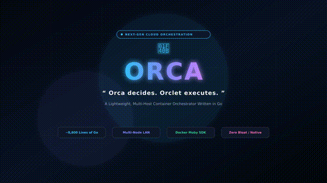

# Orca — Lightweight Container Orchestrator

A simplified, Kubernetes-like container orchestrator that manages Docker containers across multiple machines on a LAN.

> *"Orca decides. Orclet executes."*

---

## 🎯 Overview

Orca is a multi-host container orchestration platform that schedules, runs, and manages Docker containers across worker nodes. It provides scheduling, health checking, auto-scaling, high availability, load balancing, and a web dashboard — all in ~5000 lines of Go.

*Two binaries:*
- *orca* — Control plane daemon + CLI + GUI (runs on one machine)
- *orclet* — Worker agent (runs on every machine that runs containers)

## ✨ Features

- 🎯 *Resource-Aware Scheduling* — Most-Free-CPU-First placement with deterministic tie-breaking
- 🔄 *Reverse Proxy with Round-Robin* — Service traffic load balanced across healthy replicas
- 🛡️ *HA Reconciliation* — Automatic reschedule of orphaned replicas when a node fails
- 📈 *Horizontal Pod Autoscaler (HPA)* — CPU-based auto-scaling with configurable min/max/target
- 💚 *Health Probes* — Liveness and readiness checks (HTTP/TCP/exec)
- 🔁 *Restart Policies* — Always, OnFailure, Never with exponential backoff
- 🖥️ *Web GUI Dashboard* — Browser-based monitoring with auto-refresh (htmx)
- 🔧 *Full CLI* — deploy, get, scale, delete, status, token show
- 💾 *SQLite Persistence* — Cluster state survives daemon restarts
- 🔐 *Bearer Token Auth* — Simple shared-token authentication for LAN deployments

---

## 🚀 Quick Start

### Prerequisites

- *Go 1.22+*
- *Docker* in Linux containers mode (Docker Desktop with WSL2 backend or native Linux)
- *2+ machines* on the same LAN (or localhost for single-machine testing)

### 1. Clone and Build

```bash
git clone https://github.com/fardeensayyed16/orca.git
git clone https://github.com/fardeensayyed16/orclet.git

cd orca && go build -o orca ./cmd/orca
cd ../orclet && go build -o orclet ./cmd/orclet


# Orca — Lightweight Container Orchestrator



